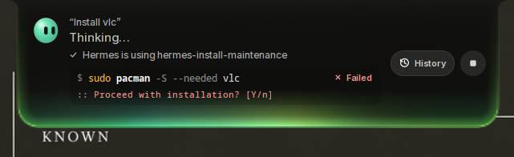
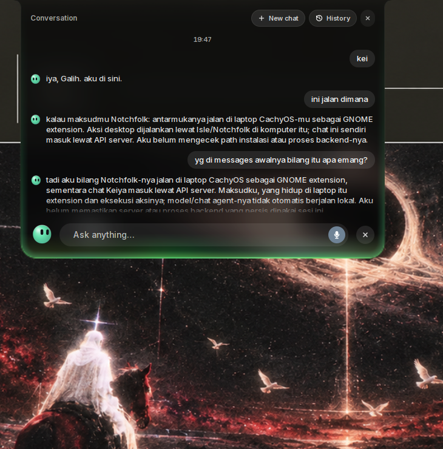
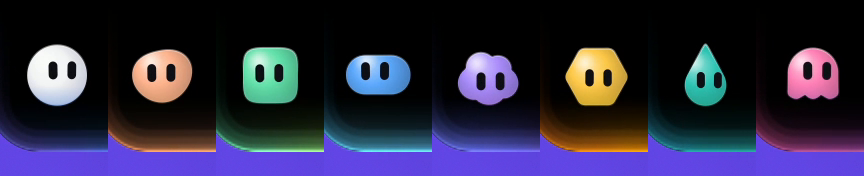
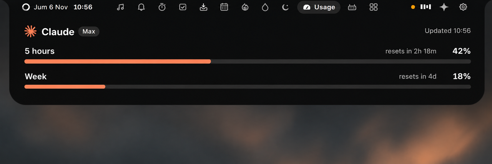
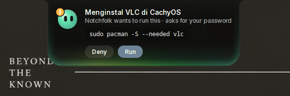

<div align="center">

# Notchfolk

**A little world in your notch.**

Your desktop notch, alive — GNOME today, Windows and macOS next. Music with synced lyrics, calls, a focus timer, calendar, food and water tracking, prayer times, weather, a file shelf, app usage, phone integration, and AI agents (Hermes, Claude Code, Grok, Codex, OMP) through a built-in MCP server — with AI router analytics and subscription usage quota tracking.

[](LICENSE)


[](https://modelcontextprotocol.io)
[](https://github.com/ggerganov/whisper.cpp)
[](https://github.com/sponsors/galyarderlabs)

</div>

Notchfolk turns the centre of the top bar into a black notch.
At rest it shows the time on the left, the assistant in the middle, and what is going on on the right:
music, a focus timer, a call, recording, or unread notifications. Its eyes follow the pointer; click or
rest the pointer on its face to open the assistant. Rest the pointer elsewhere and Notchfolk opens with spring physics into a
small panel with tabs for each page; passing over it on the way elsewhere
leaves it closed. Alerts for volume, charging, Caps Lock and notifications
appear in the same place instead of in the middle of the screen.

> [!NOTE]
> Notchfolk was formerly Isle. If you are upgrading from an Isle installation, run
> [the one-time migration script](docs/migrate-from-isle.md) once after installing,
> to carry your settings, data, credentials and services to the new names.

## Features

<table>
<tr>
<td width="50%" valign="top">
<b>Music.</b> Spotify, YouTube in your browser, or any MPRIS player: cover art with the playing app's icon, a scrubber and controls. Volume and output switching are one click away.
</td>
<td width="50%" valign="top">
<b>Synced lyrics</b> from <a href="https://lrclib.net">LRCLIB</a>: the line being sung large and bright, pauses as breathing dots. The island widens and takes the cover's colour; click a line to jump to it.
</td>
</tr>
<tr>
<td width="50%" valign="top">
<b>Calls</b> in WhatsApp, Telegram, Discord, Zoom, Meet and other call apps or call pages in a browser: the closed island shows a green phone beside the time, and the Call page how long the call has lasted. Open it to see the call live (you and whoever you call) while you work in other windows, mute your microphone, or jump back to the call.
</td>
<td width="50%" valign="top">
<b>Timer.</b> A Pomodoro timer with breaks and Do Not Disturb while you focus: a ring with the time left, the work and break lengths to type or change with − and + (they hold still from Start until Reset), and Start. Its time left stays in the closed island; beside a song or a call, it shows as a small ring on the other side of the clock.
</td>
</tr>
<tr>
<td width="50%" valign="top">
<b>Reminders</b>, with a completion count beside the list: add tasks, rename them in place, and keep finished tasks checked until midnight. A long title wraps over as many lines as it needs.
</td>
<td width="50%" valign="top">
<b>Shelf.</b> A clipboard history of text, links, images and files (search, filter, pin; Super+V to paste), and a files tray: drop files on the island, then drag them into any app or click one to copy it, ready to paste into a chat. Press <b>Phone</b> and scan the QR code to save the Shelf's files on your phone, or send photos and files from it to the Shelf, in the phone's browser: same Wi-Fi, no app, nothing through the internet. ↓ on a file the phone sent saves it into Downloads.
</td>
</tr>
<tr>
<td width="50%" valign="top">
<b>Files tray.</b> Files dropped on the island wait here, with their thumbnails, until you drag them into an app or click one to copy it.
</td>
<td width="50%" valign="top">
<b>Calendar.</b> The month beside the chosen day's events. Shows your desktop calendars (Google and others through Online Accounts) and events you add in a line: "Dinner 8:00 pm". Five minutes before an event, the island reminds you, with <b>Join</b> when it has a Google Meet, Zoom, Teams or Webex link. Under them, the time in other cities: GNOME's world clocks.
</td>
</tr>
<tr>
<td width="50%" valign="top">
<b>Notifications.</b> GNOME's notifications collect here as a plain list, newest first, with their buttons ("Reply", "Mark as read") under the pointer, Clear, and Do Not Disturb a click away.
</td>
<td width="50%" valign="top">
<b>Voice assistant.</b> Press Super+I and ask, in English or Indonesian: play a song, find a file, put windows side by side, add a reminder, explain why the laptop is slow. It works as an agent: a request with several steps is done one after another, each step checked, with the AI you already use (Claude Code, Codex, Grok, Hermes, Oh My Pi, opencode or Antigravity).
</td>
</tr>
<tr>
<td width="50%" valign="top">
<br>
<b>Installs and fixes things.</b> "Install LibreOffice", "pasang codex": it checks what your Linux has, searches the web when unsure, and shows the one command it wants to run, with what to know (your password, a script from the web, removing files). Press <b>Run</b> or <b>Deny</b>. It runs in the background while you carry on, and the assistant checks it worked before saying so.
</td>
<td width="50%" valign="top">
<br>
<b>Speak or type, and talk it through.</b> It listens as soon as it opens; start typing to type instead. Scroll up for the conversation so far; select text to copy it, + for a new one. The bot turns to the pointer, blinks, bounces with your voice and changes expression as it thinks and answers, and the light round the edge rises as you speak. Close the island and it carries on in the background.
</td>
</tr>
<tr>
<td width="50%" valign="top">
<br>
<b>A bot of your own.</b> Eight shapes, from a circle to a cloud or a ghost, eleven colours or your own, softly shaded, and a glow round the island that matches it.
</td>
<td width="50%" valign="top">
<br>
<b>AI usage.</b> How much of your Claude and ChatGPT plans' limits is used: one plan at a time with its logo, a bar per limit it has (5 hours, the week) and when each resets; scroll up or down, or click the dots, to switch. A warning comes as one nears its end. Only the ones you are signed in to show.
</td>
</tr>
<tr>
<td width="50%" valign="top">
<br>
<b>Alerts</b> for volume, brightness, Caps Lock, charging, low battery, Bluetooth devices with their battery, going offline, reminders, meetings about to start, AI plan limits and GNOME notifications with their buttons, in the same place instead of the middle of the screen. Hold the pointer on one to keep it, with a × on its icon to put it away (or swipe up). Notchfolk's own icons move once as they appear: the bolt pulses, the bell sways, rings sweep and count up.
</td>
<td width="50%" valign="top">
<br>
<b>AI agents.</b> When Claude Code or Codex asks permission to run something, answer from the island: <b>Deny</b>, <b>Allow</b> or, for Claude Code, <b>Always</b>. When one is done, the island says what it did. Nothing shows while you are in its window, and answering in its terminal works as before.
</td>
</tr>
<tr>
<td width="50%" valign="top">
<b>App usage.</b> Where your time goes: the application in front today, over the last seven days, or the last 30, with its icon, a bar and its time. Off until you turn it on, it times the app in front even when you are not typing or clicking; five idle minutes pause it unless a video holds the session awake, and locking the screen stops it. Kept on this computer for 30 days.
</td>
<td width="50%" valign="top">
<b>Glass.</b> The island in clear dark glass instead of black, if you prefer: what is behind it shows through, blurred, as you work. Choose it in Settings → Island → Appearance.
</td>
</tr>
<tr>
<td width="50%" valign="top">
<b>Router.</b> What your AI gateway reports: requests, tokens in and out and the gateway's cost estimate for today, the last 24 hours or 7 days, the top models as bars, and the last ten requests. A health dot once connected; off by default.
</td>
<td width="50%" valign="top">
<b>Everyday tools.</b> Water and calories logged through the day, and prayer times for your location, all kept on this computer.
</td>
</tr>
<tr>
<td width="50%" valign="top">
<b>MCP server.</b> An optional MCP server for agents outside Notchfolk: read tools for your data and actions, with the writes you list in <code>~/.config/notchfolk/mcp.env</code>, on loopback by default and remote access through an authenticated tunnel.
</td>
<td width="50%" valign="top">
<b>More AIs.</b> The assistant also runs Hermes and Oh My Pi with the providers they are configured for, plus any OpenAI-compatible API.
</td>
</tr>
</table>

Also: privacy dots while the camera, microphone or screen sharing is in use,
a recording timer with a stop button, and a slim glass top bar that leaves
your windows uncovered.

## Requirements

- **GNOME Shell 46 to 51** (Ubuntu 24.04 to 26.10, Fedora 40 to 45,
  Debian 13, …), on a 64-bit Intel or AMD PC (x86_64). Check with
  `gnome-shell --version`.
- `curl`, which most systems have (if not: `sudo apt install curl`). Install
  Notchfolk as yourself, not with `sudo`.
- For the voice assistant (optional): a microphone and
  one of Claude Code, Codex, Grok, opencode or Antigravity signed in (Codex and the npm
  install of Claude Code need Node.js 18 or newer); see
  [assistant guide](docs/assistant.md).

## Installation

1. Run this in a terminal:

   ```sh
   curl -fsSL https://raw.githubusercontent.com/galyarderlabs/notchfolk/main/get.sh | bash
   ```

2. **Log out and back in**: GNOME Shell on Wayland only loads a new
   extension at login (on GNOME 46 to 48 with X11, press Alt+F2, type `r`
   and press Enter instead).

That's all. The script downloads the latest release, checks it, and installs
it for your user only: no root, no compiler and no cloning needed. Run the
same command again to update; your settings stay as you set them.

The [installation guide](docs/install.md) goes through it step by step, with
updating, uninstalling, installing offline and what to do if the island does
not appear.

> [!NOTE]
> The installer never changes other extensions. When one would fight with
> the island (Blur my Shell's top bar blur, or an extension that takes the
> same place in the top bar), it says so and how to turn that off. Notchfolk's
> look is the same on every desktop: a slim top bar with no colour of its
> own, and the island as a black notch.

## Documentation

- [Usage and settings](docs/usage.md) — every gesture and shortcut, the
  Settings pages, troubleshooting and uninstalling
- [Assistant guide](docs/assistant.md) — the voice assistant, the AIs it
  runs (Claude Code, Codex, Grok, Hermes, Oh My Pi, opencode, Antigravity),
  agent approvals and AI plan usage
- [Installation guide](docs/install.md) — step by step, packages, AUR,
  offline install and other ways to install
- [MCP server](docs/mcp.md) — the optional MCP server and its permissions
- [Data and network](docs/data-and-network.md) — what is kept where and what
  leaves your computer; also [SECURITY.md](SECURITY.md)
- [How it works](docs/how-it-works.md) — the moving parts, D-Bus interfaces
  ([dbus-api.md](docs/dbus-api.md)) and resource usage

## Contributing

Bug reports, ideas and pull requests are welcome. See
[CONTRIBUTING.md](CONTRIBUTING.md) for how to build, test and send changes,
and [CHANGELOG.md](CHANGELOG.md) for what changed. Everyone taking part
follows the [Code of Conduct](CODE_OF_CONDUCT.md); please report security
problems privately as described in [SECURITY.md](SECURITY.md).

### Contributors

Thanks to everyone who has made Notchfolk better:

- [@caffeinepx](https://github.com/caffeinepx): Grok in the voice assistant
  and on the AI usage page; music from Zen and Firefox that keeps its place;
  a sun or a moon by each World Clock.
- [@Ashishranjan980](https://github.com/Ashishranjan980): the Apps page, where
  your time in each app goes.

## Support

Notchfolk is free and always will be. If it makes your desktop nicer, you can
[sponsor Galyarder Labs on GitHub](https://github.com/sponsors/galyarderlabs).
A star, a bug report or telling a friend helps just as much.

## License

Notchfolk is a modified version of [Isle](https://github.com/zickrian/isle) by
zickrian, used under GPL-3.0-or-later. Copyright © 2026 zickrian for the
upstream work; Copyright © 2026 Galyarder Labs for the modifications — both
published under the same licence.

Notchfolk is free software: you can redistribute it and/or modify it under the
terms of the [GNU General Public License](LICENSE) as published by the Free
Software Foundation, either version 3 of the License, or (at your option) any
later version. It is distributed in the hope that it will be useful, but
WITHOUT ANY WARRANTY; without even the implied warranty of MERCHANTABILITY or
FITNESS FOR A PARTICULAR PURPOSE. See the [GNU General Public License](LICENSE)
for more details.

The bundled [Inter](https://rsms.me/inter/) typeface (`data/fonts`) is under
the [SIL Open Font License 1.1](data/fonts/Inter-LICENSE.txt). Lyrics come
from [LRCLIB](https://lrclib.net). The Claude and OpenAI logos on the AI usage page
come from [Simple Icons](https://simpleicons.org) (CC0); they are trademarks of
Anthropic and OpenAI, shown only to name their plans. The assistant's face
takes its expressions from [bloub](https://github.com/jeremy-prt/bloub) by
Jérémy Perret, under the MIT License
([notice](gnome-extension/NOTICE-bloub.txt)). The calendar icon takes its shape
from [Lucide](https://lucide.dev)'s "calendar-days", under the ISC License
([notice](gnome-extension/NOTICE-lucide.txt)).

